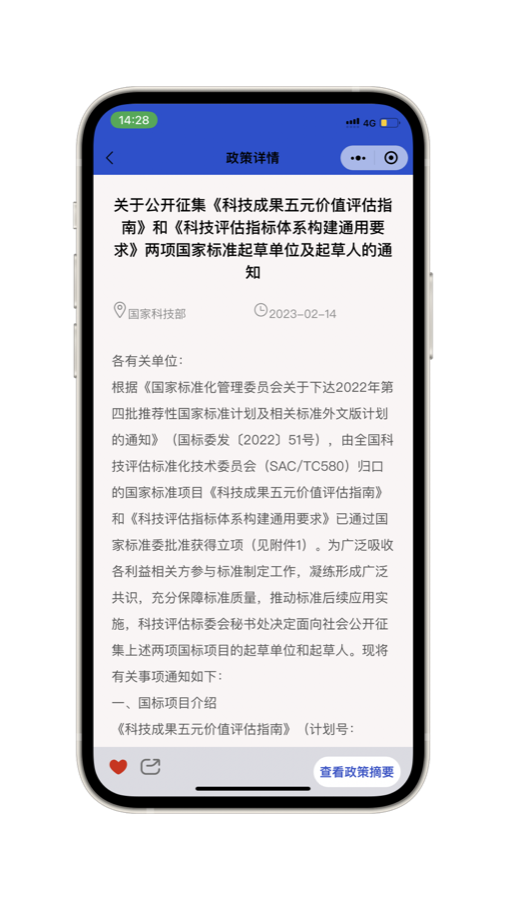
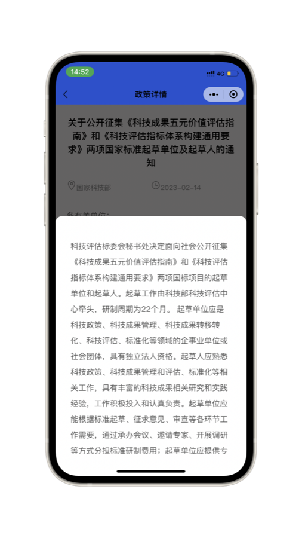
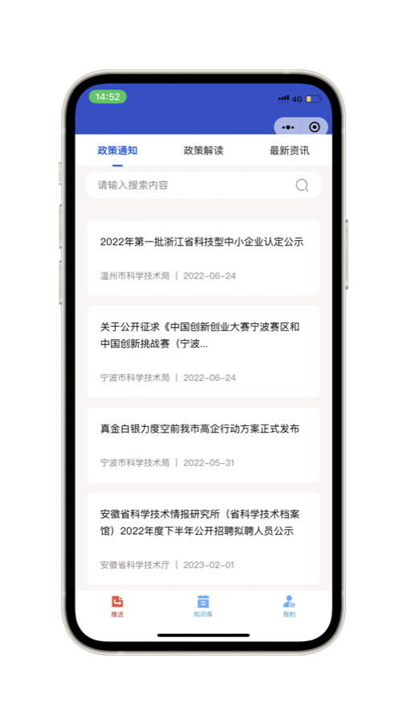
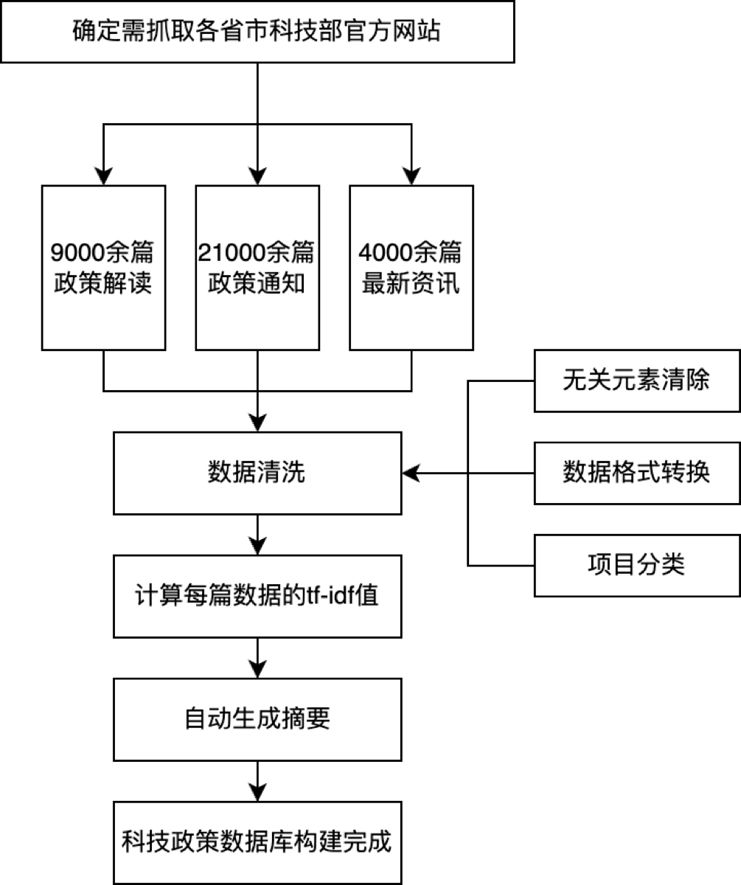

# 科政鸣：科技政策摘要生成与个性化推送小程序

面向企业和科研人员的科技政策服务微信小程序。系统采集全国 31 个省级行政区及 20 个重点城市科技主管部门发布的政策，基于指针生成网络生成政策摘要，并根据用户浏览行为构建偏好画像进行个性化推送。项目获 2023 年中国大学生计算机设计大赛江苏省二等奖。

<p>




</p>

## 背景

科技政策发布频繁、篇幅长，且分散在各级政府网站，存在获取渠道分散、阅读成本高、检索困难等问题。现有政策类产品大多不提供摘要，推送也未结合用户偏好。本项目通过自动摘要降低阅读成本，通过基于内容的推荐提高政策触达的准确性。

## 功能模块

| 模块 | 功能 |
|---|---|
| 政策知识库 | 按地区、政策类型（人才支持、创新创业、企业经营等 11 类）和内容类型（政策通知、政策解读、最新资讯）检索与筛选 |
| 摘要生成 | 在政策详情页查看自动生成的摘要 |
| 个性化推送 | 根据用户浏览记录与偏好推送相关政策 |
| 个人中心 | 浏览记录、收藏、系统通知 |

## 系统架构

```
微信小程序（WXML / WXSS / JavaScript）
        │  HTTP 请求
        ▼
Web 服务（Flask）── 摘要模型 / 推荐算法
        │
        ▼
MySQL 数据库（policy / user / record / star / push）
```

小程序发起请求后，Flask 服务查询用户偏好，计算政策与偏好的拟合度，并结合近期浏览量高的热点政策返回推送结果；知识库查询返回政策全文与摘要。

## 数据处理流程



1. **数据采集**：采集 2022 年 1 月起的科技政策 36,152 篇，其中政策通知 21,000 余篇、政策解读 9,000 余篇、最新资讯 4,000 余篇。数据来源见 `01_数据采集/数据来源.md`。
2. **数据清洗**：去除网页与公众号噪音文本，进行格式转换与分类标注，清洗后保留 34,124 篇。
3. **关键词提取**：基于自建词表与停用词表进行逆向最大匹配分词，计算 TF-IDF，每篇政策保留权重最高的 10 个关键词。
4. **摘要生成**：将正文切分为句子、去除条款序号后输入摘要模型，生成结果写回政策库。

## 关键技术

### 摘要生成

采用生成式自动摘要，参考基于指针生成网络（Pointer-Generator Network）的中文摘要模型 Text-Summarizer-Pytorch-Chinese。模型在注意力机制基础上引入复制机制，可直接从原文复制专有名词、机构名等词语。详见 `03_摘要生成/模型说明.md`。

### 基于内容的推送

1. **政策特征**：每篇政策以 TF-IDF 关键词及权重表示。
2. **用户偏好**：用户浏览政策后，将该政策的关键词及权重累加到用户偏好列表，按权重排序保留前 10 个。
3. **偏好衰减**：为避免早期浏览导致偏好固化，每日 0 点将偏好权重乘以衰减系数 0.1。
4. **拟合度计算**：用户偏好与政策关键词取交集，权重相乘后求和作为拟合度，推送拟合度最高的 20 篇，并补充近期热点政策。

## 数据库设计

| 表 | 内容 |
|---|---|
| `policy` | 政策：标题、链接、地区、发文部门、发布时间、正文、类型、摘要、TF-IDF 关键词 |
| `user` | 用户：openid、偏好关键词 |
| `record` | 浏览记录：用户、政策、时间、次数 |
| `star` | 收藏 |
| `push` | 推送结果 |

建表语句见 `05_数据库设计/schema.sql`。

## 测试结果

| 指标 | 平均响应时间 |
|---|---|
| 语义检索 | 0.250 s |
| 精准推送 | 0.156 s |

详见 `08_系统测试/测试报告.md`。

## 仓库结构

| 目录 | 内容 |
|---|---|
| `00_文档` | 数据处理流程图 |
| `01_数据采集` | 数据来源网站列表 |
| `02_数据清洗` | 政策文本清洗脚本 |
| `03_摘要生成` | 摘要模型输入预处理、结果汇总脚本及模型说明 |
| `04_关键词提取` | 分词与 TF-IDF 关键词提取 |
| `05_数据库设计` | MySQL 建表语句 |
| `06_后端服务_Flask` | 登录、政策查询、收藏、浏览记录与推送接口 |
| `07_微信小程序` | 小程序前端 |
| `08_系统测试` | 测试报告 |
| `09_演示` | 演示视频与界面截图 |

## 环境与运行

**后端**

```bash
cd 06_后端服务_Flask
pip install -r requirements.txt
mysql -u root -p < ../05_数据库设计/schema.sql
export DB_PASSWORD=...      # MySQL 密码
export WX_APPSECRET=...     # 小程序 AppSecret
python app.py
```

**前端**

1. 在 `07_微信小程序` 目录执行 `npm install`，安装 `tdesign-miniprogram` 与 `dayjs`
2. 使用微信开发者工具导入项目并构建 npm
3. 将 `app.js` 中的接口地址改为实际后端地址

数据处理脚本中的文件路径为原始开发环境路径，运行前需按本地目录修改。

## 说明

- 政策原文、清洗结果、摘要及数据库数据未包含在本仓库中
- 爬虫代码与摘要模型训练代码未包含在本仓库中
